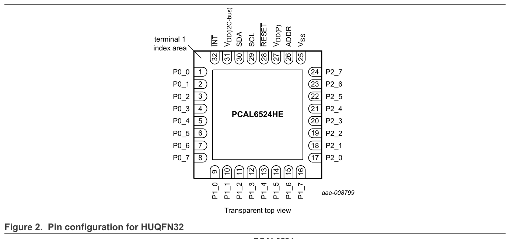
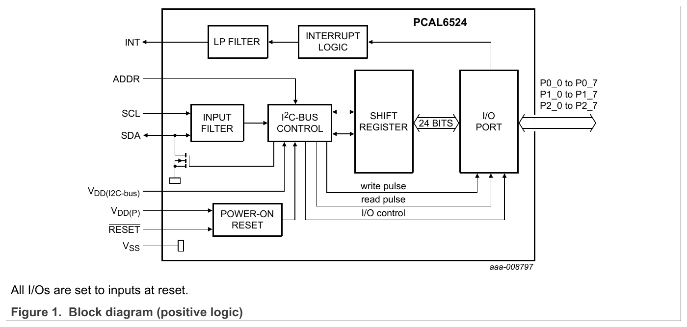
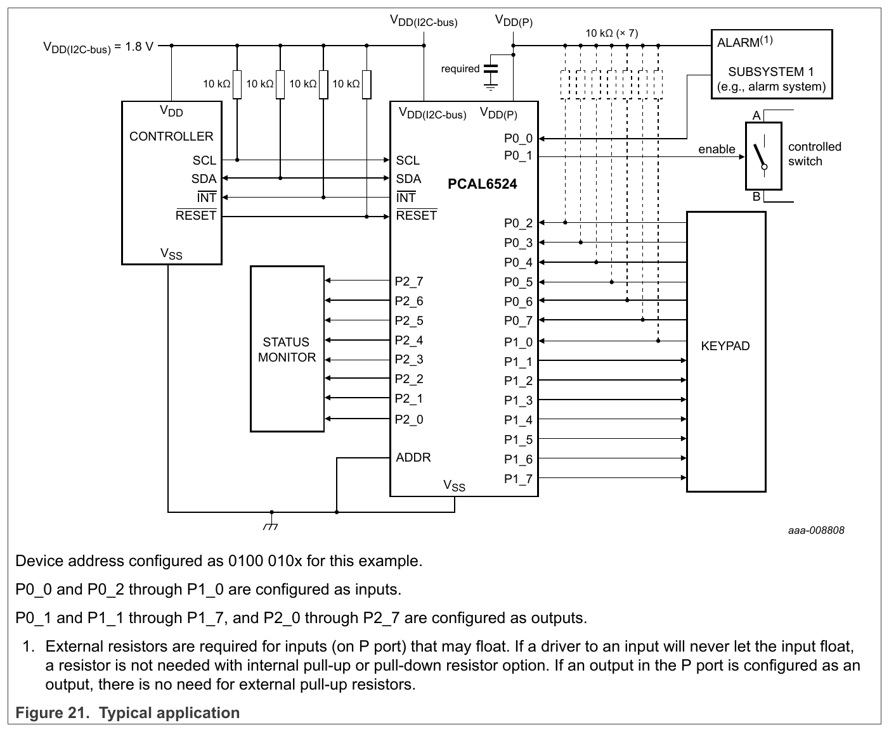
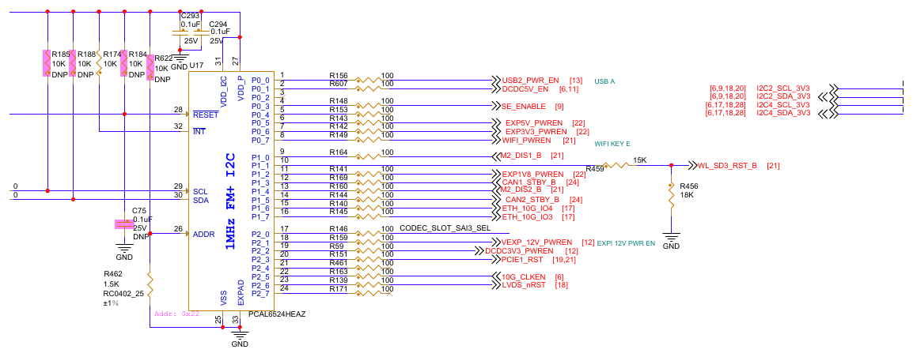
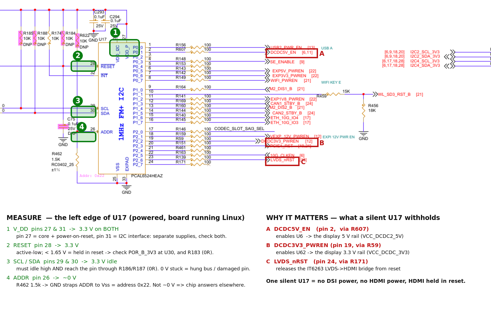

# 10 — U17 (PCAL6524) is silent: why it can fail, and how to measure it

**Board:** FRDM-IMX95-PRO. **IC:** U17 = **PCAL6524HEAZ**, the 24-bit I/O expander at **0x22 on I2C4**.
**Date:** 2026-10-21. **Tags:** `[V]` measured · `[?]` not verified · `[R]` read from the datasheet/design files.
**Datasheet:** `docs/PCAL6524DS.pdf` (Rev 2.1, 3 July 2025). **Builds on** [03](03-dsi-and-the-i2c-fault.md).

> The datasheet on its own looks like nothing to "check" — it just describes the chip. The useful
> question is the inverse: **what does this chip need to be true before it will acknowledge at 0x22?**
> Every one of those preconditions is a wire you can put a meter on. This doc turns the datasheet into
> that list, with the board's real nets, fitted parts, and expected readings.

## 1. What "it fails" means here

U17 never answers on I2C4 — `i2cdetect` finds nothing, and the kernel logs
`pca953x 3-0022: failed writing register: -110` ([03](03-dsi-and-the-i2c-fault.md) §1). Because U17 is
the only thing that switches on the panel/HDMI power rails, **nothing downstream can come up until U17
talks** (DSI panel dark, IT6263 HDMI bridge unpowered). So the whole display fault reduces to one
question: *why won't this one chip ACK?*

## 2. The datasheet facts that decide whether it can answer `[R]`

Two datasheet views carry the whole argument. The **pinout** tells you *where* to put the probe; the
**block diagram** tells you *why* each pin matters.



*HUQFN32 pinout (datasheet Fig. 2). Every pin this guide measures is on the **top edge**: 25 Vss, 26 ADDR,
27 V_DD(P), 28 RESET, 29 SCL, 30 SDA, 31 V_DD(I2C-bus), 32 INT. Pins 1–24 are the I/O port (the control
outputs on this board). Pin 33 is the thermal pad (GND).*



*Block diagram (datasheet Fig. 1). Two things to read off it: (a) there are **two supply pins**,
V_DD(I2C-bus) and V_DD(P) — not one; (b) **RESET and V_DD(P) both feed the POWER-ON RESET block**, and
until that block releases, the I²C-bus control logic is held mute. So "no ACK" can mean a supply, a reset,
or the POR — three different pins — long before it means a dead chip.*

A PCAL6524 acknowledges its address **only if all of these hold at once**. Three of them are not obvious
and are easy to skip:

1. **Two separate supplies, not one.** `[R] §2 / Fig 1`
   - **V_DD(P)** (pin 27) powers the **core logic and the port** — *and the power-on reset lives here.*
   - **V_DD(I2C-bus)** (pin 31) powers the **I²C interface** and sets the SDA/SCL level-translation voltage.
   - Measuring "VDD = 3.3 V" on one pin is not enough: the core can be dead while the interface pin is fine,
     or vice-versa. On this board both go to **VDD_3V3**, so both must read 3.3 V.
2. **Power-on reset keys off V_DD(P).** `[R] §6.7 / §8.2` The internal POR holds the chip in reset until
   V_DD(P) rises through **V_POR(trip)** — released by **≤ 1.5 V rising**, re-armed below **0.7 V falling**.
   A clean full reset needs V_DD(P) to go **below ~0.2 V and back up**. A supply that only *dipped* (e.g. a
   hot-unplug glitch) can leave the state machine stuck without a true power cycle.
3. **The RESET pin must be released.** `[R] §6.6` Active-LOW. Threshold **0.5 × V_DD(I2C-bus)** (~1.65 V).
   Held low ⇒ the chip is in reset and will not answer. Reset pulse width is only 150 ns and recovery 500 ns,
   so this is a static "is it high?" check, not a timing one.
4. **The ADDR strap sets which address it answers.** `[R] §6.1, Table 4` One pin, four addresses:

   | ADDR tied to | 7-bit address |
   |---|---|
   | SCL | 0x20 |
   | SDA | 0x21 |
   | **Vss (GND)** | **0x22** ← this board |
   | V_DD | 0x23 |

   If ADDR is disturbed, the chip answers at a **different** address — it is not "dead", it moved. (So a
   full-range scan that finds *nothing* argues against a strap problem — see §5.)
5. **SDA/SCL continuous to the controller, idling high.** Interface on V_DD(I2C-bus), pulled up by the bus
   resistors. A break between the pull-up node and the chip pin, or a damaged chip input that can't pull SDA
   low, both show as "clocks fine, never ACKs."

Standby current is **~2 µA typ @ 3.3 V** `[R] §2`, so you **cannot** tell "is it powered" from current draw
with a normal meter — go by the pin voltages below.



*Typical application (datasheet Fig. 21). This is the board in miniature: the controller's V_DD feeds
**V_DD(I2C-bus)**; SCL/SDA/INT/RESET run across to the expander; **ADDR straps to Vss** (→ 0x22); and a
single P-port pin — here **P0_1** — drives an `enable` into a "controlled switch." On the FRDM board that
exact pin, P0_1, is **DCDC5V_EN**. The datasheet's toy example and your display-power fault are the same
circuit.*

## 3. U17's real pins on this board (net + fitted part + expected) `[R]`

From `allegro/pstxnet.dat` and `BOM-95794_B1.xls`. HUQFN32 pin numbers. "Expected" = board running Linux
(RAM-booted DSI kernel), U17 un-configured.



*U17 on the board (schematic `SPF-95794_B1`, sheet 28, "IOMUX"). Read it against the pinout above. **Left
edge = the preconditions you measure:** RESET (28) ← POR_B_3V3; INT (32); SCL (29)/SDA (30); ADDR (26) →
**R462 1.5k to GND** (→ 0x22); VSS (25)/EXPAD (33) → GND; V_DD(I2C, 31) and V_DD(P, 27) → VDD_3V3 with the
C293/C294 bypass. The chip-side pull-ups **R185/R188/R174/R184 and R622 are all DNP** (pink, "DNP").
**Right edge = what U17 controls:** the P-port outputs, each through a 100 Ω series R. The three that matter
for the display fault are boxed by their net names — **P0_1 → R607 → DCDC5V_EN** (display 5 V enable),
**P2_2 → R59 → DCDC3V3_PWREN** (display 3.3 V enable), and **P2_7 → R171 → LVDS_nRST** (the IT6263 HDMI
bridge reset). So one silent chip withholds display **power on two rails and the HDMI reset** at once.*

| Pin | Function | Net | Fitted / DNP | Expected | Easy probe point |
|---|---|---|---|---|---|
| 27 | **V_DD(P)** core+POR | VDD_3V3 | direct | **3.3 V** | U17 bypass cap / any VDD_3V3 TP |
| 31 | **V_DD(I2C-bus)** iface | VDD_3V3 | direct | **3.3 V** | same rail |
| 25, 33 | Vss, thermal pad | GND | direct | 0 V | — |
| 26 | **ADDR** | N7792884 | **R462 1.5k→GND fitted**, R622 10k→VDD_3V3 **DNP** | **~0 V** (⇒ 0x22) | across R462 |
| 28 | **RESET** (act. low) | N7792018 | **R183 0R ← POR_B_3V3**, R184 10k pull-up **DNP**, C75→GND | **3.3 V** (released) | C75 / R183 |
| 29 | **SCL** | → R186 0R → I2C4_SCL_3V3 | R186 0R fitted; R185 10k chip-side pull-up **DNP**; bus R200 2.2k→VDD_3V3 | **3.3 V** idle | **J6 pin 1**, R186 |
| 30 | **SDA** | → R187 0R → I2C4_SDA_3V3 | R187 0R fitted; R188 10k chip-side pull-up **DNP**; bus R199 2.2k→VDD_3V3 | **3.3 V** idle | **J6 pin 2**, R187 |
| 32 | **INT** (open-drain) | N7792014 | R174 10k pull-up→VDD_3V3 fitted | **3.3 V** idle (no int) | across R174 |

Notes that matter for probing:
- The chip-side pull-ups **R185/R188 are DNP** — U17's SDA/SCL are held up only by the shared bus resistors
  **R199/R200 (2.2k)** at the far end. So idle-high at U17 *also* proves the bus net is continuous from the
  pull-up all the way to the chip.
- **R186/R187 (0R)** are the single series link between U17 and the bus. A crack/open there isolates U17
  while the rest of the bus looks fine — a specific, high-value continuity check.
- **J6** (a header) sits directly on I2C4 SCL/SDA (via R625/R626 0R) — the most accessible probe point for
  the bus. `[R]` ([03](03-dsi-and-the-i2c-fault.md) §6).

## 4. How to measure — in order, with what each reading means

Tools: DMM (V and Ω); a scope or logic analyzer for step D is a big help but not required.



*The measurement map, drawn on U17's own sheet. **Green 1–4 (left edge) = what you probe** and the expected
voltage, with the reason under each: `1` the two supplies (27 & 31), `2` RESET (28), `3` SCL/SDA (29 & 30),
`4` ADDR (26). **Red A–C (right edge) = why it matters** — the three P-port outputs a silent U17 never drives:
`A` DCDC5V_EN, `B` DCDC3V3_PWREN, `C` LVDS_nRST. The green points are the A1–A4 rows below; the red points
are the display rails and the HDMI-bridge reset. Probe the labelled passive or the J6 header rather than the
QFN pin itself where you can — see the table's "easy probe point" column in §3.*

### A. Powered (board running Linux), DC volts — the fast disqualifiers
Do these first; any one that's wrong is likely *the* fault.

| # | Probe | Expect | If different |
|---|---|---|---|
| A1 | U17 pin 27 **and** pin 31 (VDD_3V3) | 3.3 V on **both** | 0 V on either ⇒ supply/rail fault → trace VDD_3V3 to U17; **core (27) and interface (31) are separate — check both**. |
| A2 | U17 pin 28 RESET (C75 / R183) | 3.3 V | < 1.65 V ⇒ held in reset. Check POR_B_3V3 at U30 (74AUP1G07) output, and that R183 isn't open. |
| A3 | U17 pin 26 ADDR (across R462) | ~0 V | not ~0 V ⇒ strap wrong ⇒ chip is at a different address; re-scan 0x20/0x21/0x23. |
| A4 | J6 pin 1 (SCL) and pin 2 (SDA) idle | 3.3 V each | 0 V stuck ⇒ a device or short is holding the line low (hung bus); a damaged chip can clamp here. |

If A1–A4 are all correct, U17 **has everything it needs** and still won't ACK → go to B/C/D (continuity /
damage / dynamic).

### B. Unpowered, continuity (Ω) — is U17 actually on the bus?
| # | Probe | Expect | Meaning |
|---|---|---|---|
| B1 | J6 pin 1 ↔ U17 pin 29, and J6 pin 2 ↔ U17 pin 30 | ~0 Ω (through R186/R187) | an open here isolates U17 from the bus. |
| B2 | U17 pin 26 ↔ GND | ~1.5 kΩ (R462) | confirms the 0x22 strap resistor is present and the pad is connected. |
| B3 | U17 pin 28 ↔ POR_B_3V3 side of R183 | ~0 Ω | reset net intact to the buffer. |

### C. Unpowered, damage hunt — the 2026-09-15 incident suspicion
The fault appeared after the debug USB was yanked from the **running** board and the adapters were swapped
([03](03-dsi-and-the-i2c-fault.md) §3) — classic conditions for an ESD/overvoltage surge into I/O pins.

| # | Probe | Healthy | Suspicious |
|---|---|---|---|
| C1 | U17 pin 29 (SCL) ↔ GND, and pin 30 (SDA) ↔ GND, diode/Ω | high / normal diode drop | near-0 Ω or a leaky/low reading ⇒ blown input clamp. |
| C2 | Same pins ↔ VDD_3V3 | normal clamp | shorted ⇒ damage. |
| C3 | **Compare against a known-good PCAL:** repeat C1/C2 on **U61** (PCAL6408, I2C1, *works*) | U17 should read like U61 | a difference between the dead and the working expander is the tell. |

> Why damage is plausible as the *common* factor: [03](03-dsi-and-the-i2c-fault.md) found that **two**
> independent buses (I2C3 **and** I2C4) have **no** responder, yet the SoC drives both and the pull-ups are
> present. A surge that reached the shared 3.3 V / I²C fabric could have hit several chips' I/O pins at once.
> C1–C3 test exactly that.

### D. Powered, dynamic — watch the ACK slot (scope / LA, or the hand-clock)
Put both the controller and the bus in the simplest possible mode and look at the 9th clock:

```
# run the buses as bit-banged GPIO so the SoC controller is out of the picture:
I2CGPIO=1 board/mkdtb.sh        # (docs/03 §7) both buses become i2c-gpio on the same pads
i2cdetect -r -y 3              # I2C4 → address 0x22 lands on U17
# or one hand-clocked transaction at ~1 kHz:
board/i2cbang.sh 30 31 0x22
```

- **SCL toggles, and in the 9th (ACK) clock SDA is pulled LOW by U17** ⇒ the chip is alive and acking; the
  earlier timeouts were the controller, not the chip. (Then chase LPI2C3/4, [03](03-dsi-and-the-i2c-fault.md) §5.)
- **SCL toggles but SDA stays HIGH in the ACK slot** ⇒ U17 is not acknowledging — matches
  [03](03-dsi-and-the-i2c-fault.md) check 16. With A–C ruling out power, reset, strap, continuity and shorts,
  this points squarely at a **dead/damaged chip** (its open-drain SDA output can't pull the line down).

## 5. Reading the result

Put A–D together:

- **A full-range `i2cdetect` already finds nothing** ([03](03-dsi-and-the-i2c-fault.md) checks 14–15). A bad
  ADDR strap would only *move* U17 to 0x20/0x21/0x23, not silence it — so **the strap is not the story**
  (A3/B2 just confirm it). ✓ rules out failure mode #4.
- Doc 03 already showed **supply and reset are logically OK** (the SM brought up U61 on the same POR buffer,
  and the expanders run from VDD_3V3) — but that was inference; **A1/A2 are the direct confirmation** at U17's
  own pins. Measure them before trusting the inference.
- The lines **idle high and the SoC can drive them** (03 checks 10–12) — so the pull-up→chip net is probably
  intact, which **B1 and A4 confirm at the chip**.
- What is left, and what C + D are built to catch, is **the chips themselves**: an I/O pin damaged by the
  unplug surge so U17 can no longer pull SDA low to ACK. That it's true on **two** buses at once is explained
  better by a shared surge than by a logic fault, which is why **C3 (compare to the working U61)** is the
  single most informative measurement.

**Most likely → least likely**, given today's evidence:
1. **U17 (and U7) I²C-pin damage** from the 2026-09-15 surge — test with C1–C3, D.
2. **Open series link** R186/R187 (U17) — test with B1 (would explain U17 but not U7, so only part of it).
3. Supply/reset actually low at the pin despite the inference — test with A1/A2.
4. ADDR strap — essentially excluded by the full-range scan; B2 to close it out.

## 6. If U17 is confirmed dead: the no-U17 workaround

You don't need U17 to light the displays — U17 only *gates* the rails. Force them on in hardware and drive
the rest over the working I2C2 bus (full detail in [03](03-dsi-and-the-i2c-fault.md) §7 and the HDMI/DSI
analysis):

- **Fit R75** (10k, U6 EN) → VCC_DCDC2_5V always on.
- **Fit R194** (1k, U62 EN) → VCC_DCDC_3V3 always on.
- Then a DT where the panel ATTINY (1-0045, on the *working* I2C2) doesn't wait on the U17-owned regulators.

Both are DNP pads today; fitting them bypasses U17 entirely. Replacing a surge-damaged U17 (PCAL6524HEAZ,
HUQFN32) is the clean fix; the R75/R194 rework is the fast one.

## 7. Why the datasheet looked like "nothing to check"

Because it documents a *working* chip. The leverage is in reading it as a set of **preconditions** and asking
"is each one true on my board?" For the PCAL6524 those are exactly five things — two supplies, POR on
V_DD(P), the RESET pin, the ADDR strap, and bus continuity — and §3's table maps all five to a pin, a net, a
fitted resistor, and a number you can read with a meter. That mapping is the check.
